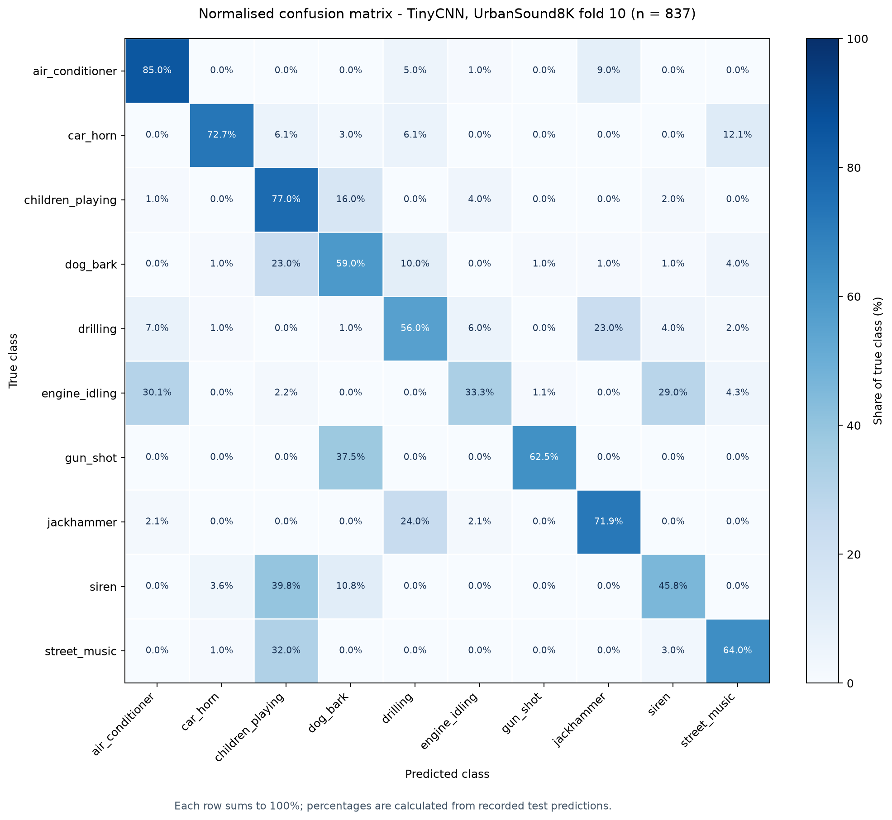

# Раздел 2.3. Оценка модели и подготовка к интеграции

Итоговая модель TinyCNN была выбрана по валидационной выборке (папка 9) и затем один раз оценена на отложенной папке 10 UrbanSound8K. Это 837 аудиофрагментов из десяти классов. Результаты относятся к компьютерному тесту; тестирование собранного устройства с микрофонами INMP441 здесь не представлено.

**Таблица 2.4. Метрики итогового теста TinyCNN**

| Метрика | Все классы (макросреднее) | car_horn | siren |
|---|---:|---:|---:|
| Точность (precision) | 0.675 | 0.800 | 0.507 |
| Полнота (recall) | 0.627 | 0.727 | 0.458 |
| F1-показатель | 0.635 | 0.762 | 0.481 |
| Число фрагментов | 837 | 33 | 83 |

Общая доля верных ответов (accuracy) составляет **0.6249**: модель правильно классифицировала 523 из 837 фрагментов. Макросреднее F1 составляет **0.6354**. Полнота `car_horn` равна **24/33 = 0.7273**, а полнота `siren` — **38/83 = 0.4578**. В частности, 33 фрагмента сирены были ошибочно отнесены к `children_playing`.

Если объединить `car_horn` и `siren` в событие оповещения после десятиклассового предсказания, получаются 65 истинных срабатываний, 40 ложных срабатываний, 51 пропуск и 681 верное отклонение. Для такого бинарного решения precision = **0.6190**, recall = **0.5603**, F1 = **0.5882**. Это отдельные показатели, их не следует смешивать с метриками отдельных десяти классов.

**Рисунок 2.5. Нормализованная матрица ошибок итогового теста.** Строки — истинные классы, столбцы — предсказанные. Каждая строка нормирована на число фрагментов данного класса. В текущем PDF номер 2.4 уже занят изображением MFCC, поэтому матрица получает номер 2.5; в ином макете подпись можно изменить на 2.4.

Для подготовленной модели сохранены файл Keras размером **114 533 байта (111,85 КиБ)** и файл TensorFlow Lite float32 размером **28 700 байт (28,03 КиБ)**. Эти числа описывают размер файлов и не показывают потребление оперативной памяти во время работы. Порог уверенности для вибросигнала в данном эксперименте не выбирался и не проверялся; итоговая классификация выполнялась по классу с максимальной вероятностью (`argmax`). Время инференса и пиковая память на XIAO ESP32-S3 не измерены, поэтому численные значения для этих полей пока отсутствуют.

**Исправления относительно исходного PDF.** В нём приведены accuracy 0,65 и macro-F1 0,66; сохранённые результаты этого запуска дают 0,6249 и 0,6354. На странице с описанием обучения число параметров TinyCNN указано как 66 128, тогда как сохранённая модель и таблица сравнения показывают **6 218 обучаемых параметров**. Тест выполнялся на папке 10, а не одновременно на всех десяти папках. Утверждение о тестах на собственных записях INMP441 не подтверждается приложенными результатами и должно сопровождаться отдельным протоколом либо быть удалено.
